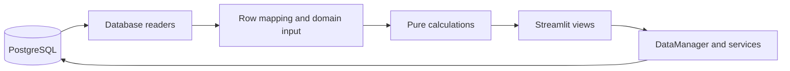

# Workout Progress Analyzer

A training dashboard that connects **what you planned, what you recorded and
what to do next**. It turns workout notes into exercise comparisons, plan
coverage and explained targets for the next session.


[](https://github.com/BaseMar/ProgressAnalyzer/actions/workflows/tests.yml)


**[Open the live demo](https://progressanalyzer-jysznkmwcjnejwamgmlfqd.streamlit.app)** ·
[Local setup](docs/getting-started.md) ·
[User guide](docs/user-guide.md) ·
[Documentation](docs/README.md)

The public demo generates fictional training and measurement data for each
browser session. You can edit workouts and plans, then reset the sandbox.
Demo browsing never connects to the personal database. Under the same URL,
the owner can choose **Personal** and unlock the saved plan with a password.
The application is designed for one owner, without registration or user accounts.


## Problem and approach

A workout log can tell you that you lifted 60 kg. To interpret the result, you
also need the exercise, repetitions, reserve, load convention and prescription
that applied on that date.

For example, `60 kg × 8 reps, RIR 2` followed by `60 kg × 9 reps, RIR 2` shows
more output at the same load and recorded reserve. RIR means repetitions in
reserve. A changed exercise or load needs a different comparison.

This application keeps the plan, performed sets and future targets separate.
Recommendations show their source sessions and explain missing evidence.

## What it does

| Page | Main workflow |
| --- | --- |
| **Overview** | Read recent observations and explained targets for the next workout. |
| **Analysis** | Explore exercise performance, plan consistency, muscle allocation and body measurements. |
| **Plan** | Build a weekly routine, save dated revisions and configure training blocks. |
| **History** | Enter or import workouts, link sessions, confirm replacements and correct set/load details. |

- **Versioned plans:** historical sessions retain their original prescription;
  compatible plan positions keep a stable history identity across revisions.
- **History-based starting loads:** reuse the exact exercise's usable history
  after a plan change, including older plans and unlinked sessions. Remembered
  manual choices cover exercises without usable history.
- **Explained progression:** per-set targets account for repetitions, reserve,
  mixed loads, equipment increments, deloads and evidence completeness.
- **Explicit load conventions:** body mass, additional weight and assistance
  remain distinct. Timed holds stay in seconds; missing RIR stays unknown.
- **Workout capture:** transactional manual entry and TXT import support
  exercise matching, warm-up labels and legacy Polish notes.

The [user guide](docs/user-guide.md) contains walkthroughs, import examples and
the [full screenshot gallery](docs/user-guide.md#screenshots).
[Calculation rules](docs/calculation-rules.md) and
[recommendation rules](docs/progression-rules.md) explain how results are derived.

## My role and engineering decisions

I designed and implemented the database model, calculation rules, import flow,
Streamlit interface and automated verification.

The project uses pure calculations and immutable domain types so a rule can be
tested without opening the dashboard. Storage owns transactions; application
services prepare shared plan/history inputs; views own forms and presentation.



One cached source-input boundary refreshes after successful application writes.
Plan/history reads are reused within one render. The
[architecture guide](docs/architecture.md) documents those lifetimes, module
boundaries, recommendation APIs and the data model.

## Stack and verification

| Layer | Tools |
| --- | --- |
| Application | Python 3.11 / 3.12, Streamlit |
| Calculations | pandas, NumPy |
| Charts and muscle map | Plotly, Pillow |
| Storage | PostgreSQL / Supabase, SQLite local demo, SQLAlchemy, psycopg2 |
| Quality and hosting | pytest, Ruff, GitHub Actions, Streamlit Community Cloud |

GitHub Actions runs linting, formatting, dependency checks, compilation and
unit, SQLite, Streamlit and PostgreSQL tests on both supported Python versions.
The PostgreSQL cases use disposable schemas and a separate test database.
Frozen synthetic outputs and read-only render benchmarks support regression
comparisons. Dated results are retained in the [verification archive](docs/archive/README.md).

For the exact commands and dependency update procedure, see
[development tools](docs/development-tools.md).

## Run locally

Try the same temporary sandbox as the public demo:

```sh
python -m pip install -r requirements.txt
streamlit run streamlit_app.py
```

No database credentials are needed for Demo. To use your saved records under
the same hosted URL, configure `DATABASE_URL` and `PERSONAL_PASSWORD_HASH`, then
choose **Personal** in the sidebar. The one-time
[hosted access setup](docs/public-demo.md#enable-personal-access-on-streamlit-cloud)
does not require a computer to remain running afterward.
`personal_app.py` remains a direct local entry point for a trusted machine.

With Docker and Compose v2 running, start the app and PostgreSQL together:

```sh
docker compose up --build --wait
```

Open **http://localhost:8501**. The first start creates fictional demo data;
subsequent starts preserve saved records. See the [Docker guide](docs/docker.md)
for prerequisites, port conflicts, persistence and reset commands.

Follow [local setup and database migrations](docs/getting-started.md) to create
the complete schema and generated demo history. The SQLite demo runs without
a database server; PostgreSQL is also supported. The example data is entirely
fictional and includes a plan, recorded workouts, muscle mappings and body
measurements. Existing installations continue to use additive migrations.

## Scope and next work

The app describes recorded performance and plan execution. It does not measure
technique, muscle growth or recovery capacity from a log. Research references
and application-specific assumptions are documented with the
[calculation rules](docs/calculation-rules.md#research-and-sources) and
[recommendation rules](docs/progression-rules.md#research-context-and-application-specific-rules).

The scope is a single-owner training tool with password-protected personal access
and a public sandbox. Multi-user accounts and registration are outside its scope.
Further import improvements will follow observed workout-note formats.

Release [v1.0.0](docs/releases/v1.0.0.md) includes separate public and personal
entry points, a generated demo, portable [backup and restore](docs/backups.md),
versioned plans and explained recommendations.

The repository uses English for documentation, interface copy, comments,
docstrings and new contribution text. User-entered names and older TXT labels
retain their original meaning; see the [language guide](docs/language-style-guide.md).
