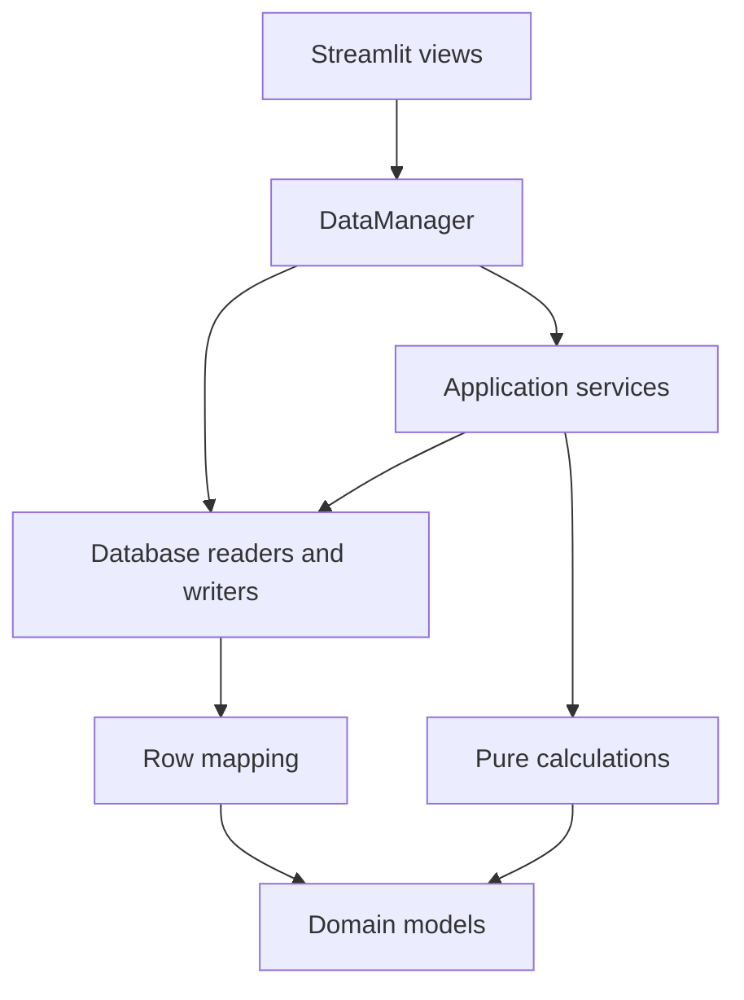
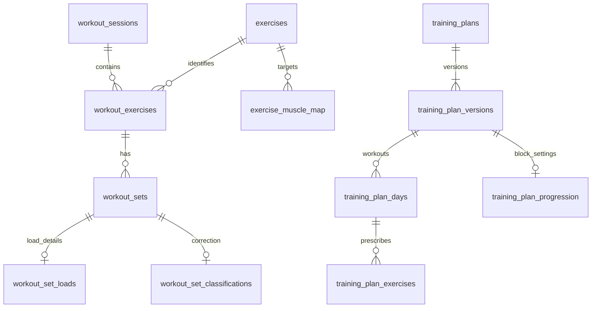

# Architecture and data ownership

This is the maintained map of the application after cleanup stages 4–7.
Historical changes and measurements live in the [archive](archive/README.md).

## Entry points and routes

`streamlit_app.py` defaults to the public sandbox with a generated, in-memory
SQLite database scoped to the browser session. Its sidebar also exposes a
password-protected Personal workspace. `ui.access_view` stops execution before
private readers, cached inputs or views until `services.personal_access` verifies
the owner. Switching workspaces, logging out or expiring a session clears UI
state and editor drafts. A `ContextVar` binds all demo readers and writers to
the sandbox engine without changing process environment variables.
`personal_app.py` reuses the renderer directly on a trusted local installation;
it is not the entry point to publish for shared hosted access.
Both entry points configure the page and render one route inside a read scope.
All routes initially share `data_loader.load_data()`. Navigation renders before
source loading, and each route lives inside a single `st.empty()` placeholder
with a route-specific container key. Replacing this block clears the previous
page before slow source loading or rendering, preventing old charts and controls
from remaining under the new route. A native spinner identifies a slow-loading
view. This does not change cache lifetimes or
authentication boundaries.

| Route | Presentation and calculation ownership |
| --- | --- |
| Overview | `OverviewView`, `NextWorkoutView`, `TrainingInsightsView`; prepared recommendations and recent observations |
| Analysis | `AnalysisView`; full recorded exercise history, plan consistency, muscle allocation and measurement timelines |
| Plan | `TrainingPlanView`; versioned routine drafts and training-block configuration |
| History | `HistoryView`, `PlanScheduleView`; entry/import, linking, replacements, set/load corrections and measurement entry |

Analysis uses stateful native `st.tabs(on_change="rerun")`, defaulting to Progress,
and checks `.open` before computing the selected tab. Rankings reuse the cached
exercise metric series through pure `metrics/progress_ranking.py`; their immutable
window evidence lives in `models/progress_ranking.py`. No extra source reads are
introduced. Exercise choices come from the full recorded catalog, while chart inputs
follow one shared Analysis period selector above the tabs. Optional measure,
load-convention and unit controls render inline within their relevant tab;
there is no Filters expander. Separate remembered area/exercise IDs survive
Streamlit widget cleanup across navigation; explicit Overview exercise links
take precedence. An empty filtered exercise is retained with a recovery action.

The muscle heat map uses native `st.html` with styles scoped to its named region
and a container-width breakpoint. It stays in normal document flow, so the
set-allocation chart follows it without retaining an old iframe viewport height
after switching between narrow and wide screens. Labels remain escaped; the
renderer does not enable JavaScript.

`ExerciseView.render()` shows recorded session means, followed by visible sections
for eligible estimated-strength history and then the latest per-set comparison.
`ui/exercise_progress_view.py` owns the two sections below the history charts.
No extra view selector or panel state is used. Comparisons receive
the already loaded full `MetricsInput` and the selected month; pure
`metrics.recorded_progress.compare_recorded_exercise` reuses Overview's history
selection and comparison rules, keeping the preceding session available across
month boundaries and retaining incomplete latest records. `InsightSet.unit`
preserves seconds even when a timed set is classified as deload or invalid.
Strength history reuses the existing per-session metric estimates and ranking
windows. No plan reads, source writes or new database queries are introduced.
Only recorded history exposes local load/unit filters; the other sections assess
complete executions or one coherent strength convention in the selected period.
Overview history links open the exercise page. `BodyMetricsView.render()` has one active display path.
History calls the existing body-measurement form for entry.
`metrics.utils.dates.to_date` is the shared date utility.

## Boundaries



Views own widgets, navigation and presentation. `DataManager` provides the
UI-facing API, chooses the configured engine and invalidates cached
input after successful writes. SQL belongs to `db/`. An explicit
`DataManager(engine=...)` supports isolated callers without loading database
configuration. Existing zero-argument construction remains supported.

`services/` coordinates reads and decisions; it does not contain Streamlit
widgets or database statements. `db/` owns query construction and transactions.
`mapper.py` converts rows into domain objects without opening connections.
`metrics/` and `models/` do not import storage, application services or UI modules.
Architecture tests protect these calculation/model boundaries.

## Prepared recommendation inputs

[`services/recommendations.py`](../services/recommendations.py) has three main
operations:

1. `prepare_plan_context` loads version snapshots and complete linked history
   for a requested plan and date window. Earlier history and early recordings
   of future planned slots remain available through the existing performance
   reader. Supplied version snapshots must belong to the selected plan.
2. `PlanReadContext.prepare_workout` selects an actual scheduled workout from
   that context. It returns a `PreparedWorkout` with the same history, versions
   and explicit evidence cutoff. The immutable types live in
   [`models/plan_context.py`](../models/plan_context.py).
3. `recommend_prepared_workout` applies the existing pure progression engine,
   then the separate exact-exercise starting-history fallback where applicable.
   A confirmed alternative reuses the prepared input and supplies its own
   exercise ID and equipment step.

Overview's **Next workout** prepares one context covering its history and four-week
preview window. Workout selection, ordinary targets and alternative previews
share those inputs. Future preview slots do not extend the evidence cutoff or
admit future logs.

Overview's **Progress** receives the already cached `MetricsInput` from the entry
point. `metrics/recorded_progress.py` compares the latest two recorded sessions
per catalog exercise, selecting latest results within 28 actual days while keeping
older preceding evidence. It does not read plan contexts or issue extra database
queries. It works without plans, links or plan storage; the active-plan selector
lives in Next workout. Recorded sources have no invented schedule or prescription
(`InsightSource` plan fields are `None`). `metrics/training_insights.py` retains
its separate plan-specific rules for plan-context observations.

The next-workout view uses the prepared workout's target identities.
`metrics/recommendation_history.py` owns the pure selection of confirmed alternatives.

Contexts are local variables rebuilt for each render. They are not written to
the database or retained in session state. Existing write invalidation and
new-render refresh remain unchanged. Callers should prepare a new context
after changing source data instead of keeping an old snapshot across writes.

## Recorded history and mapping

[`db/recorded_workouts.py`](../db/recorded_workouts.py) owns recorded-exercise
table descriptions and `load_recorded_exercises`. The reader accepts a
caller-owned connection, session IDs and an optional exact exercise-ID filter.
It reads working/warm-up corrections and optional explicit load snapshots,
without making plan matches or choosing progression evidence.

Plan adherence, usable starting-load history and raw recommendation references
share that reader with distinct selection policies:

| Consumer | Selection policy |
| --- | --- |
| Plan adherence/performance | Linked sessions and explicit exercise confirmations |
| Starting-load history | Exact exercise across plans; ordinary usable records up to the cutoff |
| Manual-start references | Entries in the latest raw session, including unlinked records |

`mapper.map_recorded_exercises` groups the returned rows and delegates each set
to `map_workout_set`. It preserves repeated exercise entries, empty entries,
per-set loads, missing RIR, timed sets and correction flags. `data_loader`
assembles `MetricsInput` through the same row mappers and one shared input cache.

## Workout persistence and shared dates

[`db/workout_sessions.py`](../db/workout_sessions.py) owns complete workout
entry/import persistence. All exercises, sets, load snapshots and explicit
classifications are written in one transaction. Same-day appending, ID/name
resolution and rollback behavior retain their existing contracts. `DataManager`
delegates to it and refreshes the shared input cache only after success.

DataFrame readers for exercise mappings and raw workout-exercise identities
live in `db/queries.py`, including the optional-mapping fallback for older schemas.
`DataManager` delegates SQL, transaction control and row mapping to their owners.

[`metrics/utils/dates.py`](../metrics/utils/dates.py) owns `to_date`. Measurement
timelines, period selection and data filters use this utility directly. It accepts
native dates, datetimes, pandas timestamps and ISO strings.

## Cache lifetime and invalidation

| Data | Lifetime | Refresh rule |
| --- | --- | --- |
| Personal database engine | Streamlit resource lifetime | Existing resource-cache behavior |
| Public demo engine | Browser-session resource lifetime | Reset discards the sandbox; session release disposes the engine |
| Mapped workout/body input and joined sets | `load_data()` cache keyed by database scope, at most 300 seconds and 128 entries | Successful application writes clear this cache before returning; demo reset clears its entry |
| Plans, schedule inputs, linked history and confirmations | Current read scope only | Every render starts fresh; writes invalidate the active scope immediately |
| Schema availability | Current read scope only | Re-read on the next render; DDL invalidates the active scope |
| Heatmap assets/HTML | Existing argument-keyed cache | Unchanged; input changes select the corresponding cached result |

Input invalidation covers workout entry/import/deletion, plan revisions, session
assignment/removal, exercise confirmations, set classifications, explicit load
corrections, measurements, catalog additions and saved manual starting loads.
Failed operations do not discard the shared input cache. `add_full_session()`
delegates to the same invalidating workout writer rather than invalidating twice.

Each sandbox has a random cache identity, so global input caching cannot return
personal or another session's rows. Context bindings unwind on reruns and errors.
Demo engine release uses Streamlit's session-scoped resource cleanup; no
temporary database files or credentials are needed. See [mode ownership](public-demo.md).

Owner sessions stay in server-side Streamlit session state and are checked on
every rerun. Idle expiry is 30 minutes, with a 12-hour absolute lifetime;
changing the configured verifier revokes previous sessions on their next rerun.
Plaintext form input is cleared in its submit callback. A process-wide limiter
reserves attempts before hashing, including concurrent submissions and new tabs.
It retains only short-lived, keyed peer digests, with five attempts per peer
and thirty overall in sixty seconds. Restarting the process clears these limits.

Read scopes use a `ContextVar`, with engine identity and service arguments in
their keys. Nested services reuse the scope; exit, early return and exceptions
discard it. Results are never retained between reruns or shared between concurrent
render contexts. Callers treat the returned collections as read-only.

SQLAlchemy listeners invalidate scoped reads before writes and again when a
written transaction commits or rolls back. Closing an ordinary read connection
does not clear the scope. Listeners are installed once before the application
engine is published, and consult the current context rather than retaining a
user's cache. They are not attached/detached on every render while other threads
may be executing queries. Caller-owned transaction adapters remain supported.

Direct database changes made outside `DataManager` require clearing `load_data`
or waiting for its five-minute expiry. Plan/recommendation readers still start
fresh on the next render. A read scope is reuse within a render, not a database
transaction-isolation guarantee for concurrent external edits.

## Data model

A **session** contains performed **exercises**, and each exercise contains
**sets**. The catalog maps exercises to muscle groups. Optional side tables
store explicit load details and set-purpose corrections.

Plans have dated versions, so an old session can be interpreted against the
prescription that applied then. Body measurements form independent time series;
they do not need a workout on the same date.

<details>
<summary>Core database relationships</summary>



| Tables | Stored information |
| --- | --- |
| `workout_sessions`, `workout_exercises`, `workout_sets` | Dates, performed exercises, reps/time, weight and RIR. |
| `workout_set_loads` | Explicit load type, per-set body mass and assistance. Added weight stays in `workout_sets`. |
| `workout_set_classifications` | Optional Working / Warm-up exceptions. |
| `exercises`, `exercise_muscle_map` | Catalog and muscle roles/factors. |
| `training_plans`, `training_plan_versions` | Stable plan identity and dated snapshots. |
| `training_plan_days`, `training_plan_exercises` | Named weekdays, order, sets, ranges, unit, RIR and weight step. |
| `training_plan_progression` | Versioned block start and length. No row means unconfigured. |
| `training_plan_session_links`, `training_plan_exercise_matches` | Planned-slot assignments and session-specific replacements. |
| `training_plan_exercise_lineage` | Stable history keys for plan positions across compatible revisions. |
| `recommendation_starting_loads` | Remembered manual fallback values, separate from performed sets. |
| `exercise_history_load_settings` | Exercise-specific confirmations of legacy body-mass conventions. |
| `schema_migrations` | Applied additive migration revisions. |
| `body_composition`, `body_measurements` | Weight/composition and body circumferences over time. |

Versions append a complete snapshot. Each starts after the previous version's
start date and cannot be backdated. Future versions do not alter earlier dates.
Multiple workouts may share a weekday; an exercise may have different targets
in different workouts.

Developer entry points:
`DataManager.save_training_plan(draft, plan_id=...)` appends a revision;
`load_training_plans()` lists latest snapshots, including future ones;
`load_effective_training_plan(plan_id, on_date)` resolves a particular date.
Draft types live in `models/training_plan.py`.

</details>

## Public recommendation API and compatibility

`DataManager.load_workout_recommendations(plan_id, day_id, scheduled_date, as_of=...)`
returns immutable `WorkoutRecommendation` and per-exercise targets, including
dates, block phase, source IDs, limitations and the rules version.
`services.recommendations` coordinates prepared inputs and the pure
`metrics.progression.recommend_workout` engine for arbitrary dates.

`db.progression` intentionally re-exports the service entry points for existing
callers. Its `load_normal_workout_recommendations` wrapper rejects deload dates.
Existing recorded-table exports in `db.plan_adherence` and the load-type export
in `ui.utils.set_load_inputs` are also intentional. New storage callers use
`db.recorded_workouts` directly. These facades do not restore the retired
aggregate metrics engine or the old input builder.

For behavior, read the [calculation rules](calculation-rules.md) and
[recommendation rules](progression-rules.md). For installation and explicit
migration commands, use [local setup](getting-started.md).

## Fresh-install schema and demo data

`db.schema.define_base_tables` owns the seven base catalog, workout, mapping
and body-tracking tables for new installations. `db.bootstrap` creates those
tables in an empty target schema, applies all registered migrations and
optionally calls `db.demo_data` within the same transaction. The resulting
twenty-table schema supports the normal readers, writers and views.

The bootstrap CLI requires an explicit URL and refuses existing tables/views.
Personal app startup does not initialize a database. The public sandbox calls
the same bootstrap against a new in-memory engine; the container launcher also
reuses it for empty targets. Existing direct installations continue through
`db.migrate`; their applied revisions are unchanged.
Demo values come from constants and offline exercise mappings, with dates
relative to a supplied reference date or today. No personal dataset is read.

SQLite is the local demo backend. Application connections enable foreign keys,
workout date/time parameters and body-tracking timestamps use explicit SQLAlchemy
types, and catalog writes use
PostgreSQL's table lock only on PostgreSQL. The transaction's existing read-cache
and input-cache invalidation rules still apply to both backends. Setup commands
and target selection live in [local setup](getting-started.md).
SQLite transaction and foreign-key handling follow the
[SQLAlchemy dialect guidance](https://docs.sqlalchemy.org/en/20/dialects/sqlite.html#transactions-with-sqlite-and-the-sqlite3-driver).

Migration 010 enables RLS on application tables and revokes public/Data API
privileges on those tables and their owned sequences. It also removes automatic
table/sequence grants for the migration role in the current schema. Later
migration runs recheck these controls. The backend connects as the table owner
or a role allowed to bypass RLS; browser/API roles cannot use that connection.
SQLite records the revision without executing PostgreSQL security DDL.
See [database access security](database-security.md) for Supabase settings and checks.
Typed parameters avoid Python's deprecated default SQLite date adapters and
retain the time of day and microseconds in body measurements. No global adapter
registration or stored-record conversion is required.

The muscle map uses Streamlit's native `st.iframe` with an accessible name and
content-based height. Its responsive HTML keeps the body overlay and status
panel visible when the layout stacks on a narrow screen. Dynamic muscle names
are HTML-escaped before embedding.

## Container startup

`compose.yaml` defines an application image and PostgreSQL 16 with a persistent
named volume. The app waits for database health, then `db.container_start`
prepares the database before replacing its process with Streamlit. Empty
targets reuse `db.bootstrap` and the synthetic seed; recognized installations
receive pending migrations without replacing records or regenerating examples.
Initialization uses the same transaction and migration lock as the standalone
bootstrap. Ordinary Streamlit startup outside this launcher does not initialize
or migrate databases.

`Dockerfile` installs only runtime requirements and application files, runs
without root and exposes an HTTP health check. `.dockerignore` restricts the
build context; Compose sets an internal database URL rather than inheriting
the host's application connection. The runtime image has no source bind mounts.
Commands and data-volume behavior are owned by the [Docker guide](docker.md).

## Inspect the module graph

```powershell
python scripts/project_inventory.py
python scripts/project_inventory.py --json
```

The standard-library script inspects Git-tracked Python source without importing
the application or connecting to the database. Counts describe the checkout
where it runs. Import reachability includes conditional/function imports and
literal AppTest scripts; it does not prove every branch executes. Source size
and test totals in archived reports belong to their measured commits.
