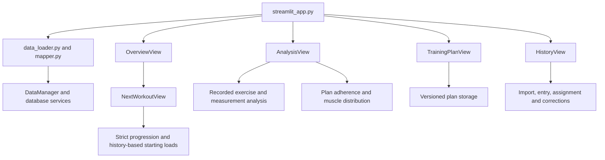

# Project inventory and cleanup candidates

> Historical record: describes its stated release or cleanup stage. For maintained guidance, start at the [documentation index](../README.md).

Stage 2 of the project cleanup. Inspected on 9 November 2026 against application
commit `0a5433b`, after the English-language standardization.

This stage inventories existing behavior and records removal/consolidation
candidates. Application code, schemas and recorded user data are unchanged by
the inventory. Performance measurements belong to stage 3; this report makes
no claims about measured speed improvements.

## Method and reproducible results

The review combined Python AST import analysis, source-reference searches,
inspection of the four navigation routes, callback/registry review, and review
of test imports, embedded Streamlit test scripts, assets and operational commands.

Run the inventory from the repository:

```powershell
python scripts/project_inventory.py
python scripts/project_inventory.py --json
```

The script reads Git-tracked Python files and parses source without importing
application modules. It needs only Python's standard library and Git. It does
not load `.env`, connect to a database, execute migrations or write a report.
The JSON output contains every application module, its importers, dependencies,
source-line count and direct test importers, including literal `AppTest` scripts.

| Source group at the inspected commit | Python files |
| --- | ---: |
| Root application modules | 4 |
| Database services and migrations | 28 |
| Metrics and calculation utilities | 34 |
| Domain models and package exports | 16 |
| Views and UI utilities | 33 |
| Application total | 115 |
| Test files, including `conftest.py` | 41 |

Application Python source totals 10,941 lines, including comments and blank lines.
The inventory script added in this stage is classified separately as tooling.

| Import classification | Modules |
| --- | ---: |
| Reachable from `streamlit_app` | 103 |
| Additional command-line entry points | 3 |
| Outside both import closures; review candidates | 9 |

Import reachability is conservative: it includes conditional and function-scoped
imports and implicit package initializers. It does not prove that every function
or branch executes during navigation. Computed dynamic imports, external API
consumers and framework-generated CSS cannot be ruled out by this analysis.
An unused import or a passing test is insufficient by itself to approve deletion.

## Active entry points and navigation

| Entry point | Responsibility and evidence |
| --- | --- |
| [`streamlit_app.py`](../../streamlit_app.py) | Loads shared source data, applies `ui/styles/main.css` and routes to Overview, Analysis, Plan or History. |
| [`db/migrate.py`](../../db/migrate.py) | Explicit schema preview/application through `python -m db.migrate`; imports the nine migration revisions. |
| [`db/seed_exercise_muscle_map.py`](../../db/seed_exercise_muscle_map.py) | Explicit administrative seeding command documented in README. |
| [`db/seed_plank.py`](../../db/seed_plank.py) | Explicit administrative setup for the timed Plank exercise. |
| [Tests workflow](../../.github/workflows/tests.yml) | Runs pytest with disposable PostgreSQL and compiles application modules. Test roots do not establish UI reachability. |

The administrative commands were inspected as source; the inventory did not run them.



| Route | Active implementation |
| --- | --- |
| Overview | `ui/overview_view.py`, `ui/next_workout_view.py`, `ui/training_insights_view.py`; database recommendation services; `metrics/training_insights.py`, `overview_summary.py` and the progression modules. |
| Analysis: exercise progress | `PlanAdherenceView.render(mode='exercise')`, or `ExerciseView.render(focused=True)` for all recorded exercises. |
| Analysis: plan consistency | `PlanAdherenceView.render(mode='consistency')`, with plan adherence, performance and summary calculations. |
| Analysis: muscle distribution | `compute_exercise_metrics`, `weekly_plan_sets`, `BodyPartsView`, the distribution table and body heatmap. |
| Analysis: body measurements | `measurement_timeline` and `BodyMetricsView.render(focused=True)`. |
| Plan | `TrainingPlanView`, plan-editor draft callbacks, immutable plan versions and block configuration. |
| History | `HistoryView`, `PlanScheduleView`, `SidebarUpload`, manual entry, exercise replacements and per-set correction controls. Body measurement entry uses `BodyMetricsView._add_measurement_form`. |

The current data path is `data_loader.load_data` plus `mapper`; it does not use
`MetricsInputBuilder` or the aggregate `compute_all_metrics` engine. Package
exports and passing function references as callbacks were considered during review.

## Modules outside the application and administrative import graphs

All nine modules below are reachable from tests. They are candidates for retiring
an earlier architecture, with test intent reviewed before removal.

| Module | Existing consumers and disposition |
| --- | --- |
| `metrics/metrics_engine.py` | `compute_all_metrics` is imported by metric, load-analysis, set-interpretation and analytics-quality tests. No production call was found. Candidate to retire with its registry. |
| `metrics/registry.py` | Supplies `METRIC_REGISTRY` to the aggregate engine. Its function objects are genuine registry references, but the engine itself has no application caller. |
| `metrics/fatigue_metrics.py` | Registered in the old engine and tested directly. Its aggregate fatigue score is outside the current decision-oriented UI. Review for removal with the old engine. |
| `metrics/frequency_metrics.py` | Registered in the old engine and tested by metric/session-comparison cases. Preserve any still-required counting rules before retiring it. |
| `metrics/progress_metrics.py` | Old cross-session summaries and direction classifications, used by the registry and tests. Current plan comparisons use `plan_performance`; recorded exercise charts use `exercise_metrics`. |
| `metrics/session_metrics.py` | Old aggregate session summaries, consumed by the registry and tests. Current History uses recorded sessions directly. |
| `metrics/set_metrics.py` | Old global set summary, consumed by the registry and tests. Shared low-level set semantics remain active elsewhere. |
| `metrics/utils/calendar.py` | `observed_week_count` supports the old frequency/session modules. A transitive dependency of the old pipeline, not an independently active application utility. |
| `metrics/input_builder.py` | `MetricsInputBuilder.build` is used by `test_input_builder.py`. Duplicates part of the active loader/mapper conversion and omits some newer input fields. Candidate to retire once required mapping cases are covered through the active path. |

The first eight modules form one legacy calculation pipeline; the input builder
is a separate candidate. Retiring the registry does **not** justify deleting
`exercise_metrics`, domain models or shared set/load helpers that active views use.
Update the old names in `metrics/__init__.py.__all__` as part of that later cleanup.

## Function and branch candidates inside imported modules

| Candidate | Evidence | Follow-up |
| --- | --- | --- |
| `SidebarUpload._parse_set_tokens` | Only its definition was found. Current parsing calls `_parse_work_tokens`, which uses `_work_token_matches` and `_set_token_matches`. No callback or test caller was found. | High-confidence removal candidate. Retain the token-match helpers used by the active parser. |
| `ExerciseView.render(focused=False)` | The application's only call passes `focused=True` from Analysis. The other branch selects the older library view, KPIs, dual trends and comparison ranking. | Retire the unused branch after checking tests and any direct callers. Keep focused analysis and load-aware charts. |
| `ui/utils/exercise_table.py` and `ui/utils/muscle_tags.py` | The comparison renderer is called only by the older ExerciseView branch; muscle tags are used by that table and tested separately. | Remove as a dependent group only after the branch is retired. Their module imports currently appear in the application graph. |
| `BodyMetricsView.render(focused=False)` | Analysis always passes `focused=True`; History uses the measurement form directly. The other branch renders old snapshot, recomposition, proportions and generated-insight sections. | Retire the old display branch without removing the active timeline, chart helpers or measurement persistence. |
| `metrics.body_metrics.compute_body_metrics` and its old summary helpers | The aggregate function is used by the old registry/tests. The module itself remains active because `measurement_timeline` imports `to_date`. | Extract/preserve `to_date` before considering the remaining old summary code for removal. Do not delete this module wholesale from a module-level scan. |
| `HistoryView._render_history(use_existing_plan=False)` and `PlanScheduleView.render_picker` | Public History rendering passes `use_existing_plan=True`. Several tests still call the private history renderer with the old default, reaching the older picker. | Review the duplicate picker path; move relevant navigation/assignment checks to the current public route before simplifying it. |
| `DataManager.load_normal_workout_recommendations` | No production or test attribute caller of this method was found. The underlying `db.progression` function is separately documented and directly tested. | The DataManager method is a wrapper candidate. Review the documented database API separately rather than deleting both together. |
| `DataManager.load_training_plan_version` | No caller of the method was found. The underlying database function is directly tested and provides immutable-version lookup. | Review the unused wrapper; retain the database lookup until its API contract is decided. |
| `ui.utils.ui_helpers.DANGER` | No reference beyond its definition was found. Nearby `WARN` and `SURFACE` are actively used. | Small constant-cleanup candidate after a final reference check. |

Tests may currently preserve an older implementation path. Keep tests for
load conventions, missing RIR, timed work, warm-ups, ordering and persistence
when moving those checks to active APIs. Retire tests whose only purpose is
asserting an intentionally removed screen or aggregate response shape.

## Consolidation and performance-review candidates

These are source-level findings. Stage 3 must establish their measured cost.

1. **Duplicate caching:** `streamlit_app._load_data_cached` wraps the already
   cached `data_loader.load_data`, both with a five-minute TTL. Inventory their
   invalidation callers before selecting one cache boundary.
2. **Repeated plan/history reads:** Overview loads versions and performance;
   `NextWorkoutView` then calls a recommendation service that loads them again.
   Alternatives can trigger a second recommendation call. Analysis similarly
   loads adherence alongside performance, whose loader calls adherence internally.
   Review a prepared input shared within one render.
3. **Broad initial loading:** all four pages first load the complete shared
   `MetricsInput` and set DataFrame. Identify which datasets each route needs
   before changing loading or caching behavior.
4. **History readers with overlapping storage access:**
   `db/exercise_starting_history.py` and `db/recommendation_references.py` both
   read raw exercise sets through `db.plan_adherence._recorded`. One searches
   all ordinary history for the latest usable start; the other displays every
   entry in the latest raw session. Preserve these distinct selection policies
   if consolidating query construction or storage access.
5. **Inference and comparison reuse:** recommendation generation and insights
   call plan-performance/set-interpretation calculations on related inputs.
   Profile before introducing shared prepared observations; date and deload
   contexts must remain explicit.
6. **Loader/mapper ownership:** consolidate conversion through the active mapper
   rather than keeping two independent dataframe-to-domain pipelines.

Removing code that is never called improves maintainability. It does not establish
a runtime speedup; use the active paths above for later performance measurements.

## Assets, dependencies and operational files

| Area | Finding and action boundary |
| --- | --- |
| `ui/styles/main.css` | Loaded by the entry point. Framework selectors, generated classes such as `.css-10trblm`, responsive rules and dynamic widget keys need browser inspection before removal. A missing literal Python match is not sufficient. |
| Inline styles and HTML | `exercise_table` styles belong to the older comparison branch. Body heatmap HTML and the clipboard component remain active. Consolidate style tokens only with equivalent rendering checks. |
| `ui/wzorzec/human_body.png` | Active image referenced by `BODY_IMAGE_PATH` in `body_heatmap.py`. The directory retains a legacy Polish name; a later move to an English asset directory must update the path and heatmap checks. It is not an unused asset. |
| `.gitignore` | Repeated environment/cache/build patterns can be simplified later. Ignore rules do not make local backups, logs or settings safe to delete. |
| `requirements.txt` | Runtime and test packages are mixed. `pytest` belongs to test tooling. `psycopg2` is documented and used by CI URLs; `psycopg` and `pyodbc` need deployment-URL review because SQLAlchemy can select drivers dynamically without direct imports. |
| `.github/workflows/tests.yml` | Active PostgreSQL test and compilation workflow. Retain it while consolidating tests or dependencies. |
| `.devcontainer/devcontainer.json` | Active development setup installing requirements and launching `streamlit_app.py`; review alongside dependency changes. |
| Local ignored files | `.env`, `.streamlit` secrets, backups, logs, caches and `user_settings` are outside the tracked-code inventory. They are not removal candidates in this stage. |

The largest application modules are `ui/sidebar_upload.py` (621 lines),
`db/exercise_muscle_resolver.py` (480), `ui/utils/body_heatmap.py` (420),
`ui/body_metrics_view.py` (385), `db/seed_exercise_muscle_map.py` (366) and
`data_manager.py` (337). Size alone does not establish a cleanup priority.
The old BodyMetrics display branch offers a clearer consolidation target than
splitting the active heatmap algorithm solely to reduce file length.

## Compatibility and behavior to retain

- All applied migration revisions 001-009 and their ledger handling. Definitions
  imported by services and explicit migration execution are separate concerns.
- Exact exercise identity and historical load conventions. Legacy kilogram values
  must not become inferred additional weight; per-exercise confirmations remain stored.
- The distinction between starting-load history and automatic increase evidence.
  Do not replace a latest-usable-history search with an unconditional latest-row query.
- Manual starting loads when usable history is genuinely absent, including their
  saved defaults. This less common route remains active.
- Explicit exercise replacements, session assignments, per-set classifications
  and load corrections. These are user operations, not obsolete alternatives.
- English output and compatibility with older Polish TXT labels and incomplete notes.
- Draft-preservation callbacks in navigation and plan editing; registry/callback
  references count even when a function is not called directly in source.
- Public facades such as `metrics/progression.py`, currently used by database
  services and tests. A small re-export module is not automatically dead code.

## Handoff to later stages

| Stage | Work informed by this inventory |
| --- | --- |
| 3: baseline | Record outputs for current routes and measure cold/warm renders, workout switches, SQL counts and calculation time. The previous stage reported 541 passing tests and six locally skipped PostgreSQL cases; this inventory does not claim a new test run. |
| 4: loading and cache | Remove redundant cache boundaries and repeated reads using baseline measurements, with correct refresh after writes. |
| 5: structure | Share prepared recommendation/history inputs, clarify mapper/storage ownership and separate the active date utility from old summaries. |
| 6: removal | Retire verified parser leftovers, old view branches, their exclusive helpers and the unused aggregate pipeline in reviewable groups. |
| 7: dependencies and checks | Separate test dependencies, decide supported database drivers and add agreed formatting/static checks. |
| 8: documentation | Archive historical implementation records and reduce README duplication while retaining the current rules and language guide. |
| 9: acceptance | Compare outputs and performance with the baseline; run UI/database checks before publication. |

Stage 2 is complete when the routes and administrative roots are mapped, every
out-of-graph module has a disposition, branch-level candidates have supporting
references, and the inventory can be reproduced without executing application code.
