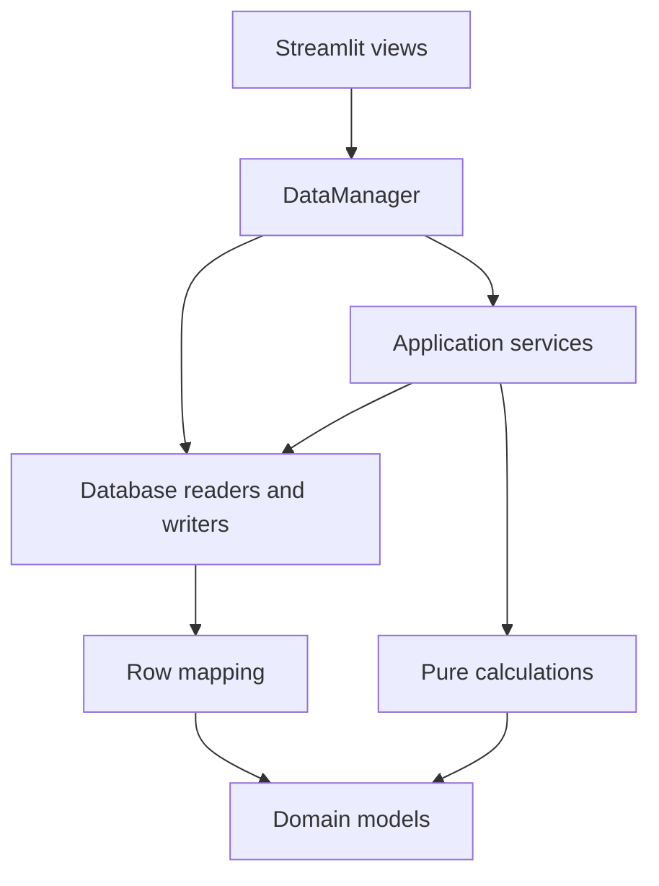

# Project structure and module responsibilities

Stage 5 organizes the active application around storage, mapping, calculations
and application workflows. It preserves the recommendation contract and the
render-scoped cache introduced in [stage 4](data-access-optimization.md).
The earlier [inventory](project-inventory.md) remains a dated baseline; this
guide describes the updated ownership of the affected modules.

## Boundaries

Views own widgets, navigation and presentation. `DataManager` provides the
existing UI-facing API, chooses the configured engine and invalidates cached
input after successful writes. It no longer executes SQL. An explicit
`DataManager(engine=...)` supports isolated callers without loading database
configuration. Existing zero-argument construction remains supported.

`services/` coordinates reads and decisions; it does not contain Streamlit
widgets or database statements. `db/` owns query construction and transactions.
`mapper.py` converts rows into domain objects without opening connections.
`metrics/` and `models/` do not import storage, application services or UI modules.
Architecture tests protect these calculation/model boundaries.

## Prepared recommendation inputs

[`services/recommendations.py`](../services/recommendations.py) has three main
operations:

1. `prepare_plan_context` loads version snapshots and complete linked history
   for a requested plan and date window. Earlier history and early recordings
   of future planned slots remain available through the existing performance
   reader. Supplied version snapshots must belong to the selected plan.
2. `PlanReadContext.prepare_workout` selects an actual scheduled workout from
   that context. It returns a `PreparedWorkout` with the same history, versions
   and explicit evidence cutoff. The immutable types live in
   [`models/plan_context.py`](../models/plan_context.py).
3. `recommend_prepared_workout` applies the existing pure progression engine,
   then the separate exact-exercise starting-history fallback where applicable.
   A confirmed alternative reuses the prepared input and supplies its own
   exercise ID and equipment step.

Overview prepares one context covering its history and four-week preview
window. Next-workout selection, ordinary targets, alternative previews and
attention annotations share those inputs. The annotation date filter still
selects the recent 28 days by actual execution date. Future preview slots do
not extend the evidence cutoff or admit future logs.

The next-workout view uses the prepared workout's real target identities;
it no longer reconstructs targets by zipping recommendation rows with a
separately loaded prescription. The pure confirmed-alternative selection rule
has moved from the view to `metrics/recommendation_history.py`.

Contexts are local variables rebuilt for each render. They are not written to
the database or retained in session state. Existing write invalidation and
new-render refresh remain unchanged. Callers should prepare a new context
after changing source data instead of keeping an old snapshot across writes.

## Recorded history and mapping

[`db/recorded_workouts.py`](../db/recorded_workouts.py) owns recorded-exercise
table descriptions and `load_recorded_exercises`. The reader accepts a
caller-owned connection, session IDs and an optional exact exercise-ID filter.
It reads working/warm-up corrections and optional explicit load snapshots,
without making plan matches or choosing progression evidence.

Plan adherence, usable starting-load history and raw recommendation references
now depend on that reader. They no longer depend on a private helper inside
the plan-adherence module. Their selection policies remain distinct:

| Consumer | Selection policy |
| --- | --- |
| Plan adherence/performance | Linked sessions and explicit exercise confirmations |
| Starting-load history | Exact exercise across plans; ordinary usable records up to the cutoff |
| Manual-start references | Entries in the latest raw session, including unlinked records |

`mapper.map_recorded_exercises` groups the returned rows and delegates each set
to `map_workout_set`. It preserves repeated exercise entries, empty entries,
per-set loads, missing RIR, timed sets and correction flags. Existing null
normalization is unchanged. The active `data_loader` continues to assemble
`MetricsInput` through the same row mappers and one shared input cache.

## Workout persistence and shared dates

[`db/workout_sessions.py`](../db/workout_sessions.py) owns complete workout
entry/import persistence. All exercises, sets, load snapshots and explicit
classifications are written in one transaction. Same-day appending, ID/name
resolution and rollback behavior retain their existing contracts. `DataManager`
delegates to it and refreshes the shared input cache only after success.

DataFrame readers for exercise mappings and raw workout-exercise identities
now live in `db/queries.py`. The optional-mapping fallback for older schemas is
preserved. No SQL, transaction control or row mapping remains in `DataManager`.

[`metrics/utils/dates.py`](../metrics/utils/dates.py) owns `to_date`. Measurement
timelines, period selection and data filters use this utility directly. Active
date handling no longer imports the old body-summary implementation simply to
normalize a date. Native dates, datetimes, Pandas timestamps and ISO strings
retain the same conversion behavior.

## Compatibility and subsequent cleanup

- `db.progression` keeps the documented recommendation entry points as exports
  from `services.recommendations`. The normal-date compatibility wrapper still
  rejects deload dates. This facade is intentional even though active UI code
  now reaches the application service directly through `DataManager`.
- Existing table imports from `db.plan_adherence` remain available for older
  fixture callers. New recorded-history callers use `db.recorded_workouts`.
- Date consumers use `metrics.utils.dates.to_date`. Stage 6 removes the old
  `metrics.body_metrics` module along with its unused summary calculations.
- The unused aggregate pipeline, old view branches and legacy input builder
  are retired in [stage 6](code-retirement.md). The active mapping path remains
  `data_loader` plus `mapper`.
- The inventory script recognizes `services/` as application code, and CI
  compilation includes the new package. No dependency or schema changes are
  required.

At the end of stage 5, the tracked-source inventory contained 122 application modules, 45 test
files and four tooling modules. The application reached 108 modules and the
three administrative entry points added three more. Of eleven modules outside
those closures, `db.progression` was an intentional compatibility facade; ten
were legacy review candidates for stage 6. Import reachability alone still
does not approve their removal.

## Verification

The semantic references established in stage 3 remain the expected outputs.
The complete synthetic render capture is also compared with stage 4, including
all nine static route outputs and upcoming-workout switching. Prepared-context
tests compare a broad preview window with independent single-workout reads,
verify alternatives reuse the same source history, and check history cutoffs,
mixed loads, bodyweight conventions and plan identity.

The machine-readable [stage 5 verification](baselines/stage-5.json) records
test results, dataset integrity and the render measurements. Read-only live
measurements are separate from the isolated PostgreSQL write/migration tests.
This structural stage makes no new algorithmic speed claim; stage 4's SQL
counts and the unchanged reference outputs are the comparison points.

The full local suite reported **578 passed, 6 skipped** in 59.3 seconds. The
six PostgreSQL write/migration cases require a configured `TEST_POSTGRES_URL`
and were not run locally. Compilation includes the new service package.

Both final benchmark captures preserved all inspected database tables,
including the existing 2531 recorded sets. The seven semantic sections, nine
captured route-output hashes on each dataset, and warm SQL counts across all
twenty cases match stage 4. No user-data corrections were made in this stage.

Representative warm PostgreSQL measurements (median of three server-side
AppTest reruns):

| Route | Stage 4 time (ms) | Stage 5 time (ms) | SQL count in both stages |
| --- | ---: | ---: | ---: |
| Overview | 2831.6 | 2704.7 | 28 |
| Plan exercise analysis | 2178.8 | 2144.0 | 23 |
| Plan | 902.2 | 915.1 | 11 |
| History | 2220.5 | 2109.7 | 22 |
| Change upcoming workout | 2801.8 | 2724.1 | 28 |

The small timing differences are not attributed to this refactor. The complete
JSON retains cold samples, individual warm samples and calculation timings;
the measurement limits in the stage 3 report continue to apply.
