# Using the dashboard

Start with the [live demo](https://progressanalyzer-jysznkmwcjnejwamgmlfqd.streamlit.app)
or follow [local setup](getting-started.md) for a configured database.
See [calculation rules](calculation-rules.md) for terminology and analytical formulas.

## Pages and filters

The app has four pages. Each answers a different question.

| Page | Start here when you want to… |
| --- | --- |
| **Overview** | Review recent progress, or open Next workout to copy training targets. |
| **Analysis** | Compare an exercise, check plan consistency, inspect muscle distribution or explore body measurements. |
| **Plan** | Create a weekly routine, edit its targets or configure a training block. |
| **History** | Browse recorded sessions, link them to a plan, import workouts or correct a set. |

One active plan is shared across the app. Analysis and History have their own
date filters; changing a historical month does not change the current plan
or the next workout.


### Progress and filters

Overview opens on **Progress**, showing **Improving exercises**, **No clear change** and **Lower results**
for the last 28 days, followed by recent observations. The counters use each
exercise's latest recorded result, independently of the active plan and top-five
observation limit. Its preceding recorded session can be outside the 28-day
window, before a plan existed, or unlinked. No plan or plan version is needed.
Only pairs with the same recorded working set count, units, per-set load convention,
load and actual reserve are graded; timed work does not require RIR. The plan's
target reserve does not affect these descriptive counts. Changed loads, reserve,
set counts, missing evidence and deloads await comparable data; observations
explain the reason. There is no recommendation-specific 21-day history cutoff.
An older positive pair never replaces an incomplete latest result. When no
exercise can be compared, cards show a dash rather than a misleading zero. Choose **Next workout** to copy the
full workout in a centered panel. The copy action is near the top; the workout
date and training phase remain visible. The active-plan selector is in this tab
and changes upcoming targets, not the recorded Progress summary.

**Analysis** opens the exercise's full recorded history, including sessions before
any plan and unlinked sessions. **Filters** contains the optional period and,
where needed, load-convention/unit controls. The chart shows mean repetitions
(or seconds) per set and mean load for each recorded session. Different load
conventions remain separate; unknown loads are gaps, not zero. These means
describe recorded work, including light and unknown-effort sets.

**Plan** uses visible **Create a new plan** and **Edit plan** actions. Its editor
keeps plan details, workouts/exercises and saving on one page. Training blocks
are optional; an existing block is preserved when editing a version.

**History** has direct **Import workout TXT** and **Enter workout manually**
actions. Calendar controls are under **Calendar settings**; session corrections
are under **Correct or delete this session** below the recorded sets.

## Your first plan and workout

1. **Create your routine in Plan.** Name the workouts, choose weekdays and add
   exercises, for example `3 sets × 6–10 reps`.
2. **Import a workout in History → Import workout TXT.** Enter an exercise manually or
   import a TXT note. Record RIR when you know it.
3. **Link the session to its planned workout in the History calendar.**
   This tells the app which prescription the log belongs to.
4. **Read Analysis, then Overview.** Analysis explains recorded results;
   Overview shows the upcoming target when enough comparable evidence exists.

Saving a new plan selects it automatically and updates muscle targets.
For an exercise without usable history, **Choose starting loads** provides a
remembered fallback. A recorded and linked workout establishes the evidence
for ordinary progression. A block calendar is needed for automatic deloads;
ordinary progression also works without it.

## Training plan and next workout

### Build a weekly routine

In **Plan**, choose **Create a new plan** or select a saved plan:

1. Set the name and effective date.
2. Add named workouts and weekdays; select one **Workout to edit**.
3. Add exercises and set their counts, ranges and unit: reps or seconds.
4. Set target RIR and an available weight step in the exercise fields.
5. Save. To revise a saved routine, choose **Edit plan**.

A revision preserves earlier plan versions. Draft values survive switching
exercises or pages.

### Configure a training block

Under **Progression & training block**, choose a start date and a length of
6, 7 or 8 weeks. The last week is reserved for deload.

```text
Example: a repeating 7-week block
Weeks 1–6: ordinary training → Week 7: deload → next cycle
```

Weeks are seven-day intervals from the start date, including midweek starts.
Missed workouts do not move the schedule. Saving a revision preserves block
settings unless you explicitly change them.
Ordinary progression also works without a configured calendar; the calendar
controls automatic deloads.

### Read the next target

**Overview → Next workout** previews an unlinked planned workout from today
onward. Choose another upcoming date to see all planned exercises and their targets.
Every exercise is visible directly, with its relevant notes and source sessions.
Overview's numeric next action comes from that same preview.

**Copy preview** uses a short note with empty **Time:**, **Result:** and **RIR:**
lines. Append your actual values after training; no placeholders need to be removed.
Targets remain separate suggestions and are ignored during import.

Starting suggestions use the exact exercise's usable history, including older
plans and unlinked sessions. The source entry is shown with the current range
and RIR. An exercise without usable history keeps **Choose starting loads**;
complete manual choices are saved, the form disappears, and **Edit starting loads**
reopens them. Actual history takes priority over saved manual defaults.

Selecting **Use a confirmed alternative** previews that exercise's own history.
The selection does not edit the plan or confirm a future exercise replacement.
For load equalization, failure corrections, deloads and bodyweight limits, use
the [recommendation rules](progression-rules.md), which own the decision policy.

## Recording and importing workouts

### Manual entry and bodyweight sets

Choose **History → Enter workout manually** for reps/seconds, weight,
RIR and set purpose. For explicit bodyweight work, weight means **additional kg**;
body mass and assistance have separate fields.

History shows the saved load components.
**Body mass and load details** corrects an individual set.
Older logs keep their original kg convention until explicitly corrected.

### TXT workout import

Choose **History → Import workout TXT**, or use the sidebar shortcut:

```text
Time: 15:35-16:50

1. Incline Dumbbell Press
10x24 / 10x24 / 6x26
RIR 2 / 2 / 0

2. Lat Pulldown
12x70 / 10x70 / 11x70
RIR: 1 / 0 / 0
```

`10x24` means **10 repetitions at 24 kg**. Slashes separate sets;
the RIR values follow the same order.

| Also accepted | Example |
| --- | --- |
| Alternative set notation | `10 x 100 kg`, `10*100`, `10 @ 100` |
| Decimal comma | `10x67,5` |
| Exercise numbering | `1.`, `1)`, `1 -` |
| Inline exercise | `Bench Press: 10x100/8x110 RIR 2/1` |
| Time range | `Time: 10:30 - 12:45`, `Time: 15.35 to 16.50` |
| Missing RIR | Leave it out; the value stays unknown. |

Unknown exercise names can be matched to the catalog or added as a new exercise.
Before importing explicit bodyweight sets, open **Review body mass and load types**
and check the convention and estimated total. The default preserves the TXT log's
original kg meaning. An import saves all exercises together or rolls back.

Previously saved Polish notes remain supported, including `Godzina`/`Godz.`
time labels, `Cel:` target lines and `Wynik:` result lines. New exports use English.

<details>
<summary>Warm-up markers and timed dead hang examples</summary>

Mark set purpose explicitly when useful:

```text
1. Bench Press
Warm-up: 10x20 / 8x40
Working: 8x60 / 8x60
RIR: 4 / 3 / 2 / 1
```

`Rozgrzewka:` and `Robocze:` work too. Unmarked sets keep an empty stored
label and are interpreted during analysis. Explicit exceptions are stored
separately from the original set values.

For dead hang, record each hold as its own duration:

```text
1. Dead hang
Working: 30s / 45s / 1:00
```

This gives three timed sets of 30, 45 and 60 seconds.
Choose **Measure = seconds** in the plan. RIR may stay empty; repetitions in
reserve do not mean seconds in reserve.

The TXT duration notation does not encode added hanging weight.
Use the import load review or manual entry to set the load components.

</details>

### Link a workout or confirm a replacement

In **History**, select a planned calendar day and link its recorded session.
The actual workout may be on another date. A session belongs to one planned slot;
removing a link preserves its log.

If you used another exercise, open **Confirm exercise replacements** on the
linked workout. For example, Machine Chest Press can cover a Barbell Bench Press
position for that session. Their performance histories stay separate.

<details>
<summary>Calendar and matching rules</summary>

- A bottom dot marks a recorded session. A top-right amber ring marks planned
  work; it fills teal when every planned slot on that date is linked.
- Slots use the plan version effective on their scheduled date.
  A new version cannot replace an already linked slot; unlink it or choose
  a later effective date.
- Matching exercise catalog IDs are automatic. Similar muscle groups alone do
  not confirm a replacement. Replacements must use the same unit: reps or seconds.
- Confirmed replacements reserve the recorded exercise for one plan position.
  Remaining exact-ID sets are allocated in plan order without double counting.
- Unlinking/deleting a session removes its replacement approvals.
  Deleting the session also removes the link; unlinking alone keeps the workout.
- Analysis uses scheduled dates for plan periods and loads moved linked sessions
  in full. A moved workout counts as recorded, but not on the planned day.

</details>

## Screenshots

On the hosted app, choose **Demo** or **Personal** in the sidebar. Demo uses
fictional data without a password. Personal asks for the owner's password before
loading saved records. **Log out**, or switching back to Demo, closes personal
access and clears the current editor state. See [hosted access setup](public-demo.md).

Captured 10 November 2026 with Streamlit 1.66.1 and entirely fictional data
generated by the public sandbox. Desktop captures use 1440 px; mobile captures
use 390 px. Images show the interface at capture time; see the
[v1.0.0 release notes](releases/v1.0.0.md) for release scope.

<details>
<summary>Hosted workspace and owner login</summary>

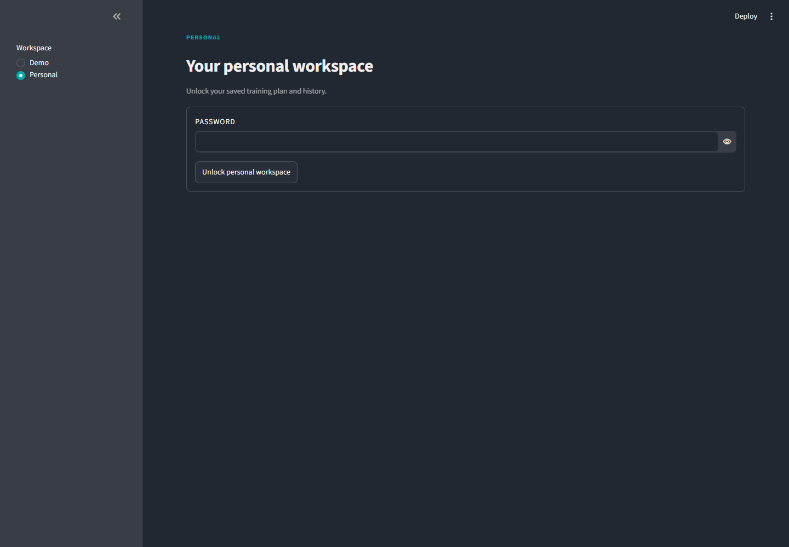
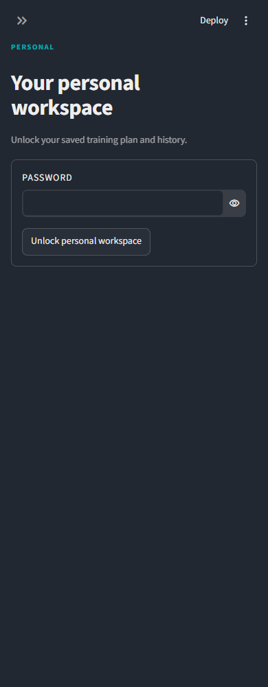

</details>

<details>
<summary>Analysis: exercise, plan, muscles and body measurements</summary>

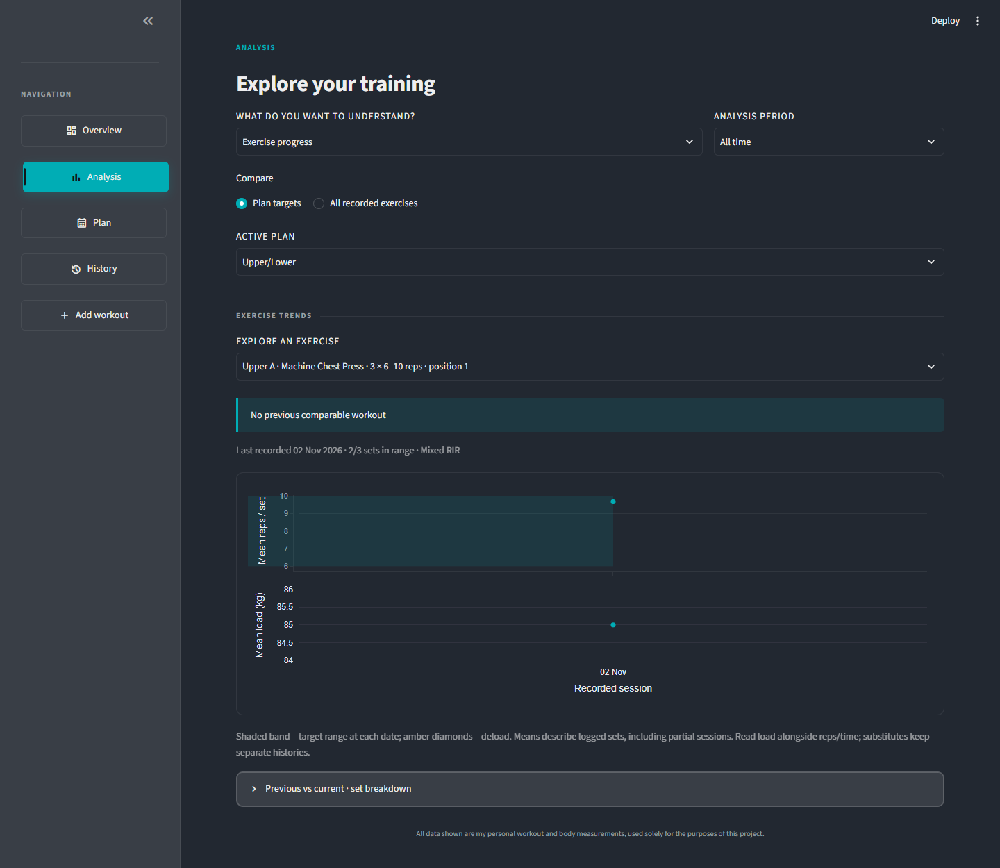
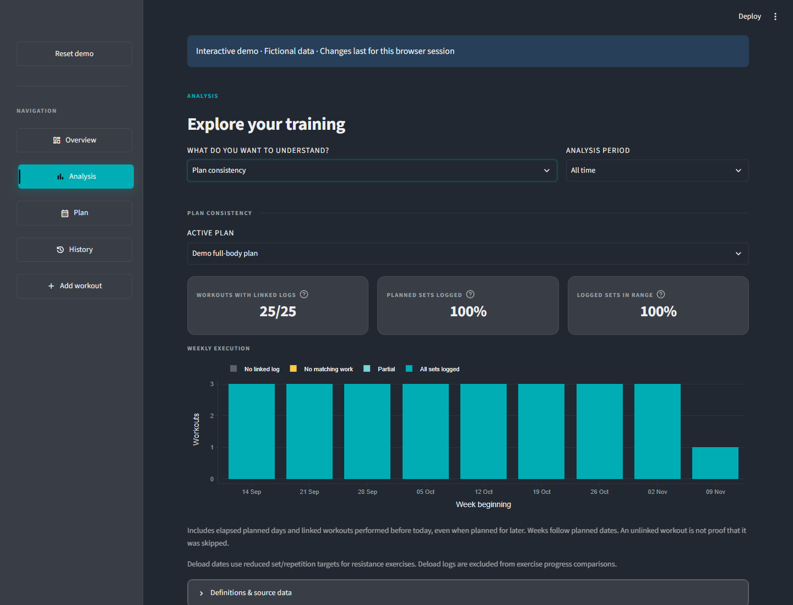
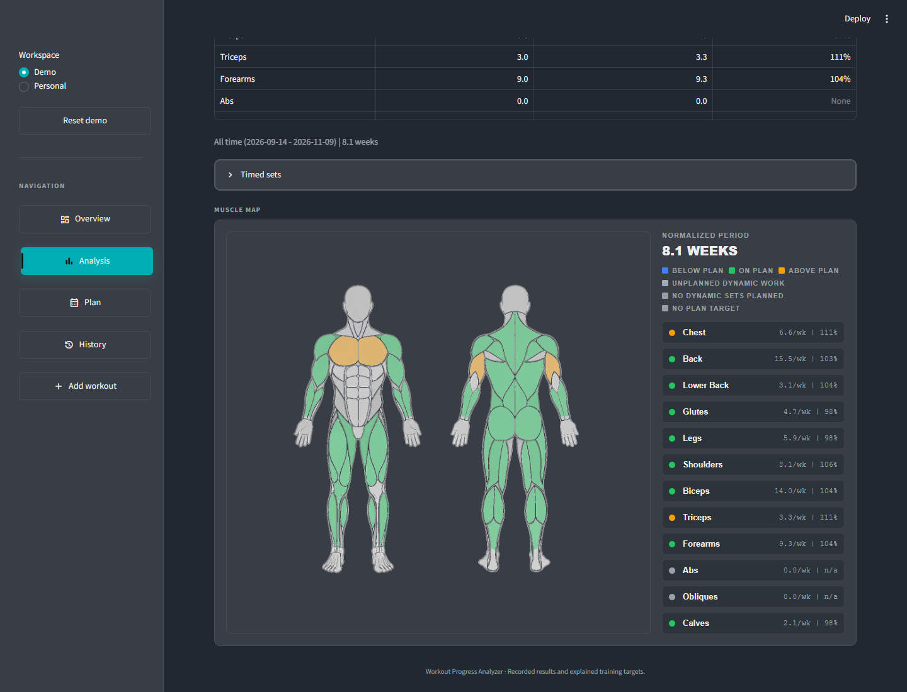
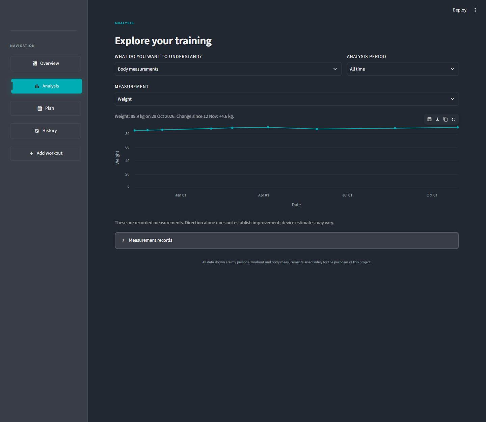

</details>

<details>
<summary>Plan and workout history</summary>

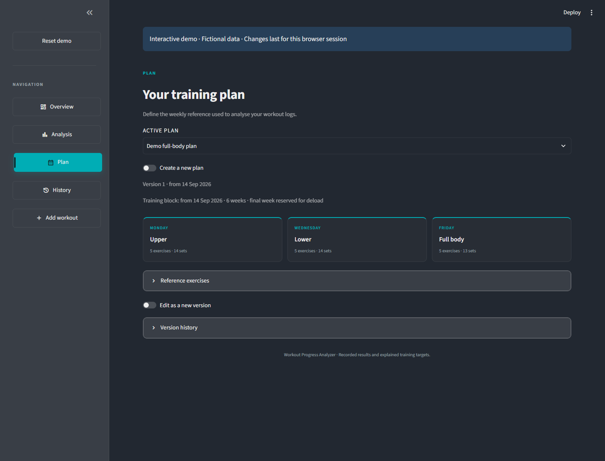
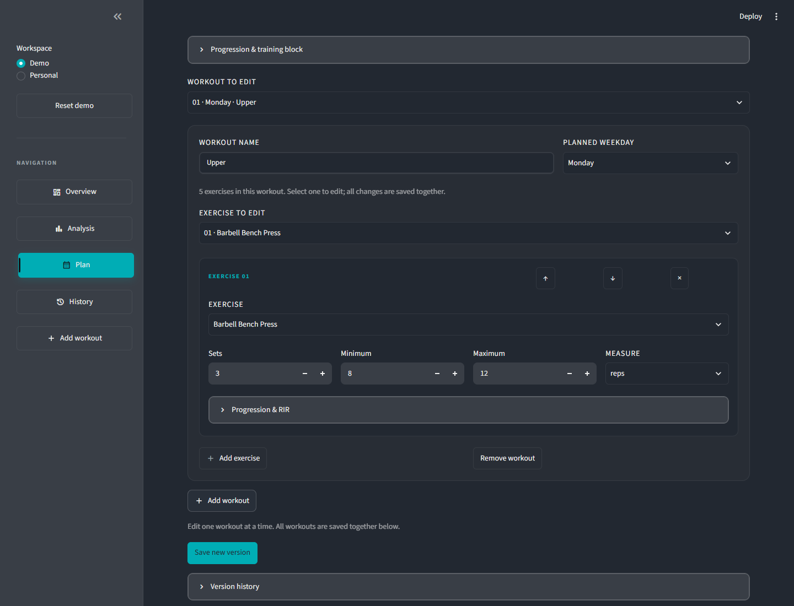
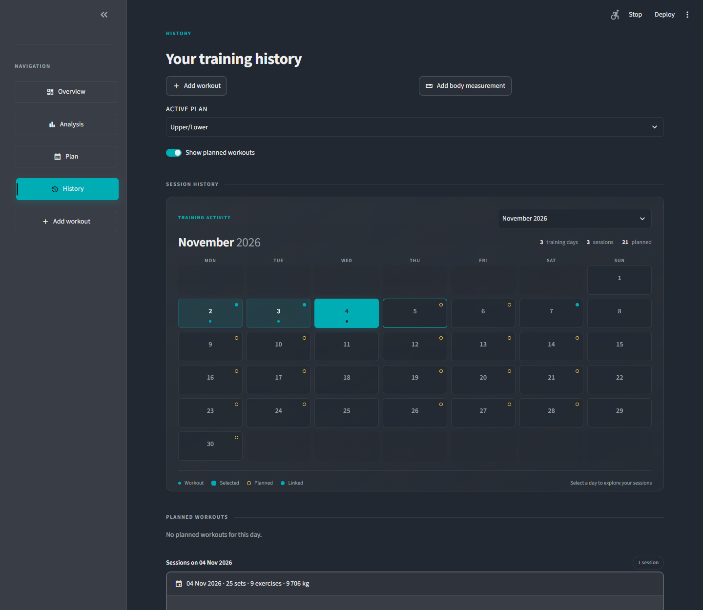
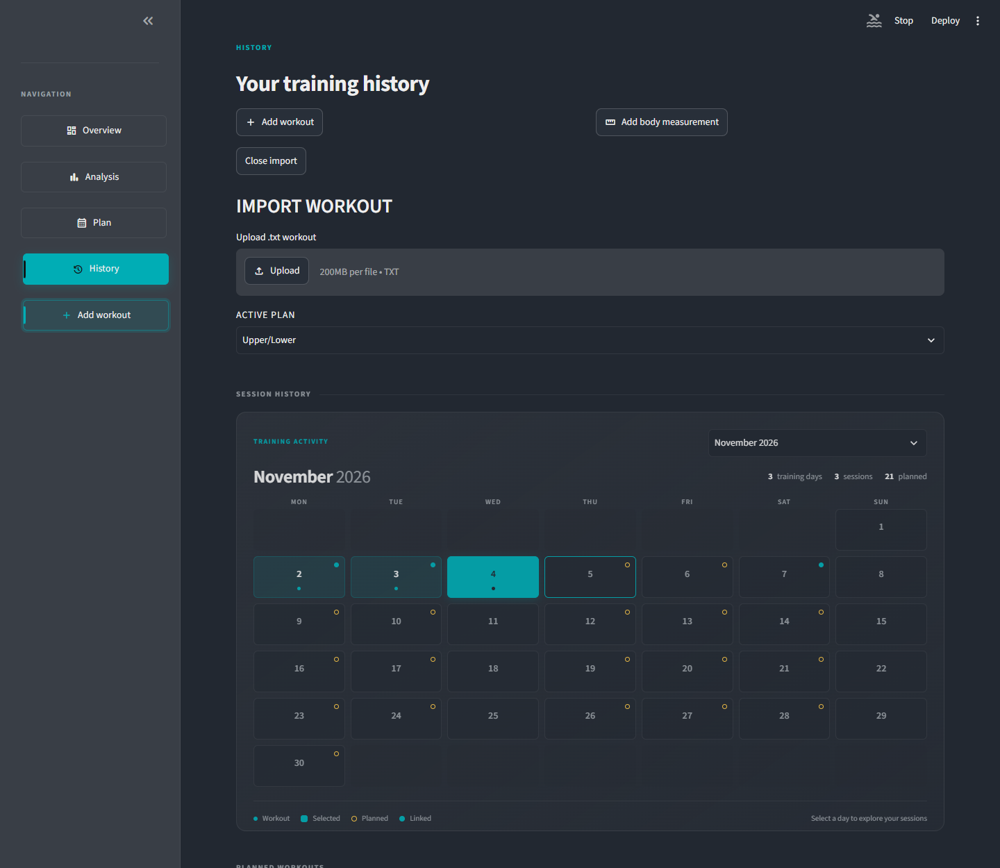

</details>

<details>
<summary>Mobile layouts</summary>

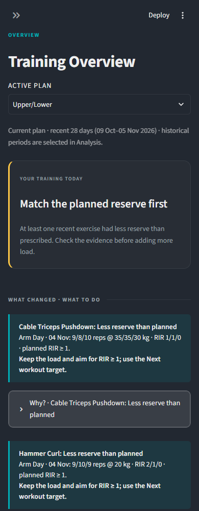
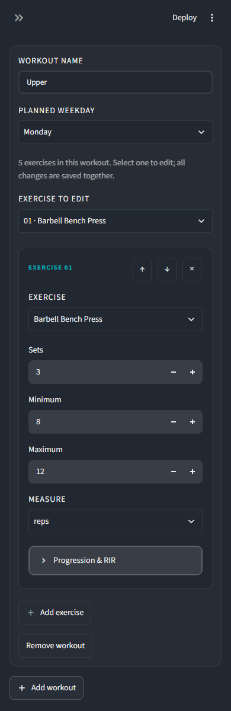
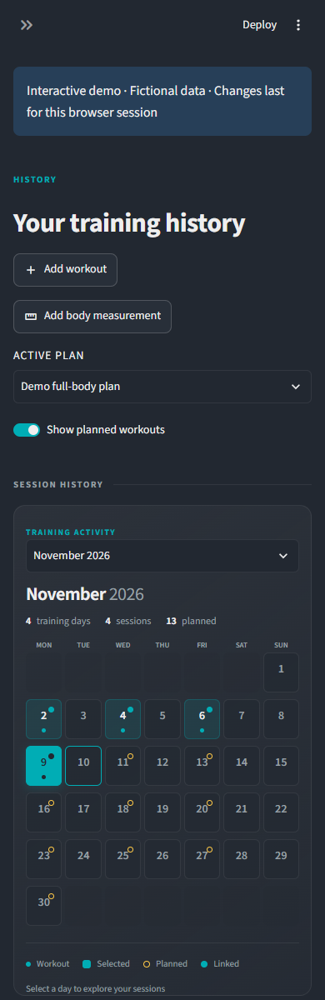

</details>


See the [first UX iteration screenshots](../screenshots/ux-iteration-1/README.md) for desktop and mobile examples of these workflows.


### Highlighted observations

Within **What changed - what to do**, **Largest improvement** appears first and
**Result to review** follows when a comparable lower result exists. They are
selected from all latest comparable exercise results before the five-observation
limit, using relative changes in total reps or seconds at unchanged loads and
reserve. Highlights are not repeated in the remaining observations. Missing data,
changed conditions and deloads never manufacture a positive or negative highlight.

Select a highlighted exercise name to open its full recorded history in Analysis.
This opens **Exercise progress** with **All time**, clearing an earlier date filter
so it cannot hide the selected exercise.

Highlighted observations place the bold label and underlined exercise name on one
line when space permits. The accented name and right arrow open exercise history;
long names wrap on narrow screens. Keyboard focus remains visible.
